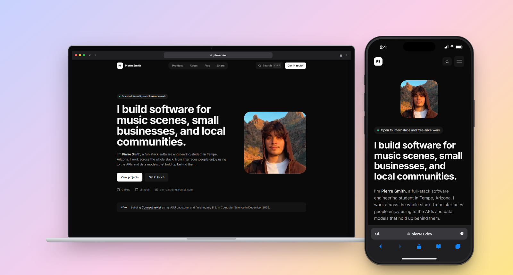
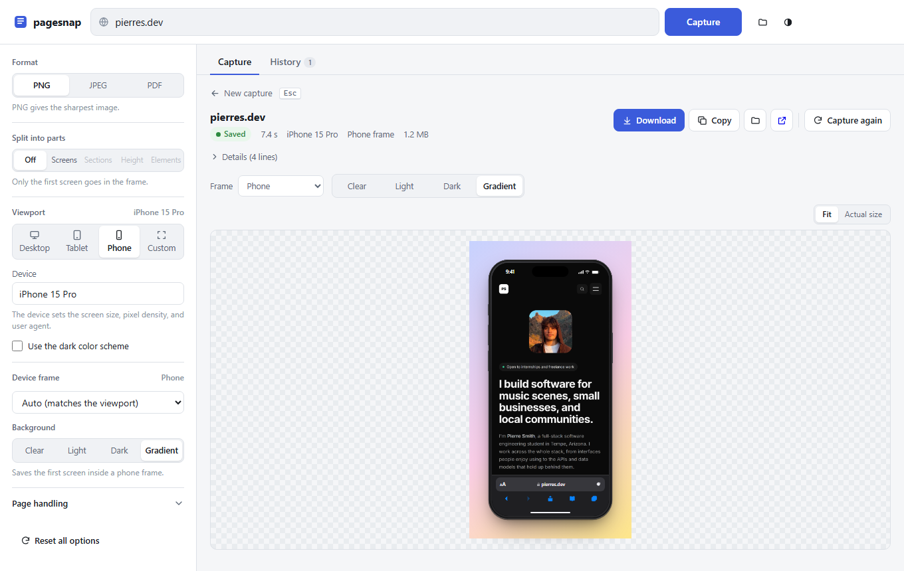

# pagesnap

Full-page screenshots from the command line or an optional local web UI: PNG, JPEG or PDF, split into parts or shown inside a phone, tablet, laptop or browser frame. Capture one page, or a whole list of pages at once. Works on Windows, macOS and Linux (needs Node 18.3+).



Handles the things that usually break full-page captures:

- **Lazy-loaded images**: scrolls the whole page first and forces `loading="lazy"` to eager, then waits for images.
- **Infinite scroll**: keeps scrolling until the page stops growing, capped by `--max-height` / `--max-scrolls`.
- **Cookie banners**: clicks "Reject all" (falls back to "Accept"), including inside consent iframes, then hides known CMP banners (OneTrust, Cookiebot, Sourcepoint, Didomi, Quantcast, Usercentrics...) and undoes scroll locks.
- **Sticky headers / floating widgets**: fixed and sticky bars render once at the top; bottom-anchored chat bubbles and overlays are removed.
- **100vh sections**: pinned to pixel heights so heroes don't stretch.
- **Reveal-on-scroll animations**: pages load with reduced motion requested, and scroll-driven CSS animations (`animation-timeline: view()`) are turned off. Otherwise, sections that fade in as you scroll can be invisible in the capture.
- **Very tall pages**: images over ~16,000 device px are split into numbered parts (`page-01.png`, `page-02.png`, ...).

## Install

```bash
npm install
```

Chromium downloads automatically on first run (one time, ~150 MB, cached per user).
To get a global `pagesnap` command:

```bash
npm link
```

To move it to another machine, copy the folder without `node_modules` and run `npm install` there.

## Usage

```bash
pagesnap https://example.com
pagesnap https://news.ycombinator.com -o hn.jpg -q 70
pagesnap https://github.com -d "iPhone 15 Pro" -o gh-mobile.png
pagesnap https://en.wikipedia.org/wiki/Web_page -f pdf
pagesnap https://example.com -w 1920 -H 1080 -s 2 --dark
pagesnap https://example.com --split sections -o parts/example.png
pagesnap https://example.com --slice-height a4
pagesnap https://example.com --parts ".card" --parts "footer"
```

### Capture a list of pages

Give several URLs, or a text file with one URL on each line. Every page gets the same options. Blank lines and lines that start with `#` are skipped, and `--list -` reads the list from standard input.

```bash
pagesnap example.com example.com/pricing example.org --out-dir shots
pagesnap --list urls.txt -d "iPhone 15 Pro" --out-dir shots/mobile
pagesnap --list urls.txt -j 6 --format jpeg
```

- The pages share one browser, and `-j, --parallel <n>` of them load at the same time (default 3, at most 16).
- Each file is named after its page, for example `example.com_docs_intro.png`, in `--out-dir` (default: the current folder). `-o` is for a single URL only.
- Every URL is checked first. If one is not valid, nothing is captured and the bad ones are listed.
- One page failing does not stop the others. At the end, the failed pages are listed with their errors and the exit code is 1. Ctrl+C cancels the pages that are left.

### Split into parts

The `--split` option saves one capture as several images, like A4 pages in a PDF. It works with PNG and JPEG.

| Mode | One image for each | Example file names |
|---|---|---|
| `--split screen` | screenful (the viewport height), from top to bottom | `site-01.png`, `site-02.png` |
| `--split sections` | section of the page: header, hero, each section, footer | `site-01-header.png`, `site-03-pricing.png` |
| `--slice-height 1200` | slice of 1200 px. `a4` and `letter` use that page shape at the page width. | `site-01.png`, `site-02.png` |
| `--parts ".card"` | element that matches the selector. Repeat `--parts` for more selectors. | `site-01-starter-plan.png` |

- **Screens** and **height** do not cut through content. Each cut moves up, by no more than a quarter of a slice, to the best gap nearby:
  - It never goes through a line of text, an image, a video, or a form control.
  - It does not go through a card or a paragraph when a gap outside them is in reach.
  - It goes in the middle of the gap.

  So slices are at most the size you asked for, and often a little shorter. Use `--exact-cuts` for slices of exactly the same size.
- **Sections** follows the page's own layout. It goes down through wrapper elements and follows the main column past sidebars. It cuts at section edges, so together the parts cover the whole page and no content is lost between them.
- **Elements** saves each element's own box, not the full page width. A selector that matches nothing is an error.
- Each part keeps the same page cleanup as a full capture. A fixed header shows one time, in the first part.
- A part that is taller than the browser limit (about 16,000 device px) is cut into more parts.

Without `npm link`: `node bin/pagesnap.js <url> [options]`.

The saved file paths are printed to stdout (progress goes to stderr), so it scripts cleanly.

| Option | Default | |
|---|---|---|
| `-o, --out <file>` | `<host>.<fmt>` | Output path; extension picks the format |
| `--list <file>` | | Capture every URL in this file, one on each line (`-` reads stdin); repeatable |
| `--out-dir <dir>` | current folder | Where a list's files go (with `--ui`: where the UI saves captures) |
| `-j, --parallel <n>` | 3 | Pages of a list that load at the same time (1 to 16) |
| `-f, --format` | png | `png`, `jpeg`, `pdf` |
| `-q, --quality` | 85 | JPEG quality |
| `--pdf-paged` | off | A4 pages instead of one long PDF page |
| `--split <mode>` | none | `screen`, `sections`, `height`, `elements` (PNG/JPEG) |
| `--slice-height <h>` | | Slice height in px, or `a4` / `letter` (sets `--split height`) |
| `--parts <css>` | | Element selector, repeatable (sets `--split elements`) |
| `--exact-cuts` | off | Screens/height: cut at exact multiples, even through content |
| `--frame <kind>` | none | `auto`, `phone`, `tablet`, `laptop`, `browser`: the first screen (or every screen) inside a device |
| `--frame-bg <bg>` | transparent | `transparent`, `light`, `dark`, `gradient` |
| `--frame-time <text>` | 9:41 | The status bar clock on phone and tablet frames |
| `--frame-date <text>` | Tue Jan 9 | The date next to the clock on tablet frames. `""` hides it. |
| `--url <url>` | | `pagesnap frame` only: the address bar text |
| `-w, --width` / `-H, --height` | 1440 / 900 | Viewport |
| `-s, --scale` | 1 | Device scale factor (2 = retina) |
| `-d, --device <name>` | | Device emulation; `--list-devices` shows names |
| `--dark` | off | `prefers-color-scheme: dark` |
| `--user-agent <ua>` | | Override UA |
| `-b, --browser` | chromium | `chromium`, `firefox`, `webkit` (PDF needs chromium) |
| `--cookies` | reject | `reject`, `accept`, `hide`, `off` |
| `--sticky` | once | `once`, `hide`, `keep` |
| `--no-scroll` | | Skip the lazy-load scroll pass |
| `--max-height` | 20000 | Stop infinite scroll past this many px |
| `--max-scrolls` | 60 | Scroll step cap |
| `--hide <css>` | | Hide extra elements (repeatable) |
| `--wait <ms>` | 500 | Settle time before capture |
| `--wait-for <css>` | | Wait for a selector first |
| `-t, --timeout <ms>` | 45000 | Navigation timeout |
| `--headed` | off | Show the browser (debugging) |

### Device frames

`--frame` puts what a screen shows inside a device, for portfolios and product pages:

```bash
pagesnap https://example.com -d "iPhone 15 Pro" --frame auto -o phone.png
pagesnap https://example.com --frame laptop --frame-bg gradient
pagesnap https://example.com -d "iPhone 15 Pro" --frame phone --split screen -o screens/phone.png
```

| Frame | What it draws |
|---|---|
| `phone` | Bezel, side buttons, Dynamic Island, a 9:41 status bar, the Safari bottom bar with the site's domain, and the home indicator |
| `tablet` | Bezel, camera, status bar, and the iPad Safari toolbar |
| `laptop` | Lid with camera, a browser window bar, and an aluminium base |
| `browser` | A browser window with traffic lights and the address bar |
| `auto` | Picks one from the viewport: phone below 600 px wide, tablet below 1100 px, laptop above. A device from `--device` uses its own type. |

- The frame holds the **first screen** of the page, the way a real screen shows it. With `--split screen`, every screen gets its own frame, as if you scroll on the device. Fixed headers stay at the top of each screen, and the last screen ends at the bottom of the page.
- The status bar takes the color at the top of the page (or its `theme-color`). Its text is light or dark to match. The browser bars go dark on a dark page, or with `--dark`.
- `--frame-bg` sets what is around the device: `transparent` (default, a PNG with an alpha channel), `light`, `dark`, or `gradient`. JPEG has no transparency, so a transparent JPEG gets a light background.
- `--frame-time` sets the clock in the status bar of phone and tablet frames. The default is 9:41, as in Apple's own screenshots. `--frame-date` sets the date next to it on tablets (default `Tue Jan 9`, and `""` hides it). Laptop and browser frames have no clock. `pagesnap frame` takes both too:

  ```bash
  pagesnap https://example.com -d "iPhone 15 Pro" --frame phone --frame-time 10:30
  pagesnap frame shot.png -w 834 -H 1112 --frame tablet --frame-time 7:05 --frame-date "Sat Oct 18"
  ```
- Frames are drawn with HTML and CSS at the capture's pixel density, so a 3× phone capture stays sharp. No image files are downloaded.
- A frame works with no split or with the Screens split, and with PNG and JPEG only.

#### Frame a capture you already have

`pagesnap frame` puts an existing image in a frame without loading the site again. It takes one or two seconds, against five to twenty for a new capture. Use it to try several frames, or for a page that you cannot load again.

```bash
pagesnap frame example.com.png --frame laptop --url https://example.com
pagesnap frame phone-shot.png -d "iPhone 15 Pro" --frame-bg gradient --url https://example.com
pagesnap frame page-01.png page-02.png page-03.png --split screen -o framed/page.png
```

- Give the image, or the parts of a split capture in order.
- The viewport comes from `-d` or `-w`/`-H`. Without them, the width is the image width and the height is 900.
- The pixel density comes from `-s`, else it is the image width ÷ the viewport width.
- `--url` sets the text in the address bar.
- `--split screen` frames every screen instead of only the first.
- The output is `<image>-framed.png`, unless you give `-o`.

The result is the same as a framed capture, with one difference. With every screen, a fixed header shows only on the first screen, because the full-page image has it only at the top. For a header on every screen, capture again with `--frame`.

In the UI, **Frame this** does the same for any saved capture. It is in the result toolbar and on each History card.

## Web UI (optional)

```bash
npm run ui
```

Or `pagesnap --ui` after `npm link`. This starts a small server on `http://localhost:4777` and opens it in your browser. It needs no extra dependencies and works offline.

<picture>
  <source media="(prefers-color-scheme: dark)" srcset="docs/ui-dark.png">
  
</picture>

- Type a URL and press Enter. Press `/` to go to the URL field from anywhere on the page.
- Four steps show the progress: Load, Clean up, Scroll, Save. The Scroll step shows how far down the page it is. Click **Cancel** to stop a capture.
- When the capture is done, the preview shows the image at the page's real width. A 3× phone capture shows at phone size. **Fit** and **Actual size** change the zoom. You can also click the image.
- **Download**, **Copy** (images only), **Show in folder**, and **Capture again** are above the preview.
- **Device frame** in the sidebar has the same frames as `--frame`, and shows which frame **Auto** picks for the viewport. While a frame is on, the splits that a frame cannot use are switched off. In **Fit** zoom, the preview shows the whole device.
- **Frame this** puts a saved capture in a frame. It does not load the site again. Pick the frame, the background, and the first screen or every screen. It is in the result toolbar, and on each History card as the phone button.
- **Change a frame at once.** A framed capture shows a strip with **Frame**, **Background**, and (for phones and tablets) **Time** and **Date** above its preview:
  - When you change them, the preview redraws at once, also while you type a time. **Now** puts in the time and date now. The browser draws the frame with the same code the server uses (`lib/snap/frames.js`).
  - About half a second later, the server saves the new images in place. The strip shows "Saving…" and then "Saved". Download and Copy wait until the save is done.
  - The sidebar's **Device frame**, **Background**, **Status bar time**, and **Date** also change the framed capture on screen. For a new capture, they set its frame.
  - This works because a framed capture keeps its unframed screens in `captures/.frames/<capture>/`. When you delete the capture, that folder goes too.
  - A capture that was framed before this feature has no saved screens, so its strip is off. Use **Capture again** to make a new one.
  - To change the phone model or the viewport, use **Capture again**. Those change how the page itself is laid out.
- **Split into parts** in the sidebar has the same modes as `--split`. The preview shows each part with its name and its own download button. **Download all** gets every part in one ZIP file.
- **List** (next to **Capture**) captures many pages at once. Paste or type one URL on each line, or load a `.txt` or `.csv` file. Pasting several URLs into the URL field opens the list too. Lines that are not URLs are shown with their line numbers before anything starts.
  - Every page gets the sidebar's options. Three pages load at the same time; the others wait.
  - Each page has a card that shows its progress, then its thumbnail or its error. **Open** shows the capture, and **Back to the list** (or Esc) returns.
  - When the list ends, **Download all** gets every saved page in one ZIP file, **Try again** captures the pages that were not saved, and **Edit list** changes the list. **Cancel** stops the whole list.
- If a capture fails, the error says what went wrong and what to do. **Try again** repeats it with the same options.
- **History** shows each capture with its URL, viewport, size, and age. Type in the search field to filter the list. **Again** repeats a capture with its original options. To delete a capture, click the trash button two times.
- The sidebar has every CLI option. The UI keeps your options and theme between visits. On a phone, the options fold into one line.
- Captures go to `./captures` as `<host>-<timestamp>.<ext>` (pages of a list as `<host>_<path>-<timestamp>.<ext>`). The URL and options of each capture go to `captures/.pagesnap-history.json`. Framed captures also keep their unframed screens in `captures/.frames/`. Two UI servers can share one folder safely.
- Captures run one at a time. Extra requests wait in a queue.

| UI option | Default | |
|---|---|---|
| `--port <n>` | 4777 | Falls back to a free port if 4777 is taken |
| `--out-dir <dir>` | `./captures` | Where captures are saved |
| `--no-open` | | Don't open a browser tab |

The server only listens on `127.0.0.1`. It rejects requests with a foreign `Host` or `Origin` header, so other websites you have open can't drive it, and it only serves capture files from the output folder. Stop it with Ctrl+C.

## Limits

- Sites with bot protection (Cloudflare challenges, some image sites) may serve a block page to headless browsers.
- Pages behind a login aren't supported yet.
- Long single-page PDFs are capped at 200 in (19,200 px) by the PDF format; beyond that Chromium paginates.

`test/torture.html` is a local page that exercises every case above:

```bash
node bin/pagesnap.js "file:///$PWD/test/torture.html"
```
